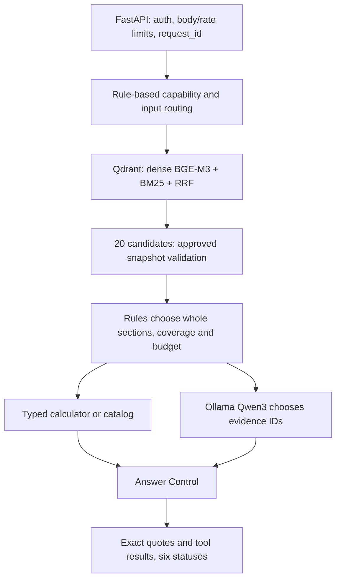

# Блок6 — Final Evaluation & MVP Acceptance

Дата20.10.2026. **Итог MVP: PARTIAL.** Техническая цепочка работает, но независимое качество и tail latency не достигли критериев. Рекомендация — один ограниченный этап исправлений, затем новый заранее размеченный holdout. Enterprise-интеграции и frontend не нужны для устранения найденных причин. Следующий этап автоматически не начат.

База2ccd35f, data1.1 неизменны. Plan/54 новых формулировки зафиксированы241cb9f до inference;12 development и42 final. Исправления development зафиксированы89087a9 до final. Финальный набор выполнен один раз; после его результатов runtime и разметка не менялись. Проверка сохранённых hashes это подтверждает. Это синтетический набор и техническая оценка по источникам/контрактам с разбором агентом, без независимого слепого human judge или реальных пользовательских данных.

## Фактическая архитектура

Реальный hybrid search выполняется, но pool20 охватывает весь corpus20. Выбор контекста в основном задают словарные правила, а не итоговый top5. LLM выбирает evidence IDs; свободный синтез ответа не реализован. Готовых ответов по точному тексту вопроса нет, однако понимание формулировок ограничено routing/context rules. Число настоящих LLM calls само по себе не доказывает разнообразное понимание намерений. Reranker выключен, API stateless, внешние orders/CRM/payment/handoff connectors отсутствуют.

Qwen3:0.6b GGUF Q4_K_M, Ollama0.33.2, digest7df6b6e09427a769808717c0a93cadc4ae99ed4eb8bf5ca557c90846becea435. Context8192/output512, CPU2 threads/GPU0,temp0,seed42,think=false. BGE-M3 approved FP32 ONNX1024/Cosine и BM25 остаются прежними. Платных и облачных inference calls0. Local API fee0 исключает электричество/оборудование.

## Критерии, заданные до запуска

| Критерий | Наблюдение | Gate |
|---|---|---|
| Final scenario pass ≥85% | 29/42 = 69.05% | NOT MET |
| Expected-answer completeness ≥85% | 20/29 = 68.97% | NOT MET |
| Extractive source fact integrity =100% | 100%, scoped to exact approved quotes; not semantic relevance | PASS |
| Detected critical secret/action/calculation failures =0 | 0 | PASS |
| Typed calculation accuracy =100% | 5/5 | PASS |
| Real completed final LLM calls ≥18 | 18 | PASS |
| Warm business HTTP p95 ≤30s | 60.927s | NOT MET |
| Model-unloaded cold readiness ≤180s | 64.66s; OS file cache not flushed | PASS |
| Real dependency errors safe | 5 boundary +2 actual dependency probes | PASS |
| Real restart persistence | 20 IDs/full payload/dense/sparse and alias | PASS |
| Clean clone reproducibility | fresh47-package venv,212unit,13Server contracts,3real HTTP | PASS |

Grounding gate здесь проверяет точность утверждённых полных quote units и tools. Это ограниченный extractive-контракт, не независимая семантическая валидация любого текста. F10 показывает, что фактически правильный источник может быть неподходящим ответом. Поэтому общий итог остаётся PARTIAL, даже когда source integrity и unit/CI проверки проходят.

## Независимые результаты и определения

| Метрика | Результат | Знаменатель/граница |
|---|---:|---|
| Строгий scenario contract pass |29/42 = 69.05% |status, необходимые sources/facts, расчёт, source integrity и безопасное действие |
| Completeness ожидаемых ответов |20/29 = 68.97% |включая случаи, где система отказала/упала вместо полного ответа |
| Fact correctness/grounding источников |100% выданных проверенных units |exact approved text/ID; это не correctness намерения и не universal entailment |
| Корректность отказа/уточнения по статусу |9/13 = 69.23% |не означает13 решённых задач |
| Typed calculation accuracy |5/5 =100% |pricing передан структурированно, NLP parsing корзины не проверен |
| Совпадение класса пути |32/42 = 76.19% |LLM/tool/control, не semantic intent accuracy |
| Завершённые реальные LLM calls |18 |21 попытка,3 timeout;2 завершённых LLM ответа получили insufficient_context |
| Detected unsafe secret/action/arithmetic |0 |проверенные случаи и detectors, не доказательство общей безопасности |

Всего21 answered:20 полных соответствующих сценариев и1 неподходящий ответF10. Часть остальных статусов корректно ограничивает возможности, часть ошибочна. Счётчики категорий не являются долей решённых клиентских проблем. Текстовые подборыF19–F22 не доказали полноценный выбор на естественном языке: два запроса получили предусмотренное контрактом уточнение, один timeout, один insufficient_context. Typed catalog проверялся отдельно, в сохранённых contracts.

Retrieval на29 запросах с непустым relevance set: **Recall3=0.844828,Recall5=0.931034**. Macro доля уникальных required source sections в top-k, не ответная accuracy.13 запросов с ожидаемым control/refusal и пустой разметкой исключены из Recall, не получили искусственный score1. Другой состав набора не позволяет трактовать разницу с Блоком3 как изменение модели. Перечни потерянных источников сохранены для каждого query.

Показательный разрыв: F10 top5=DR-05, DR-04, PL-05, DR-02, DR-06, нужныйDR-05. Фактический ответ использовалPL-01: слово «оплатит» направило контекст в оплату вместо ошибки комплектации. Это потеря после retrieval, а не доказательство плохого embedding. F03 top5=DR-03, DR-01, DR-05, DR-06, DR-04: общий вопрос о том, где искать трек, ошибочно переведён в requires_external_data. F01/F08 после настоящей LLM остановлены coverage gate: существенные разделы не выбраны. Справочный source validation не заменяет независимую проверку пригодности ответа вопросу.

Все42 статуса/потери: [матрица](block-6-scenario-results.md).10 реальных HTTP-примеров с удачами и неудачами: [чтение](block-6-real-examples.md), [полные ответыJSON](block-6-real-examples.json). Два диалогаA/B отправлены последовательно без клиентских hints/history rewriting; продолженияF38/F41 не обработаны, полноценная память не заявляется.

## Development: подтверждённые исправления

До исправлений9/12, после12/12 с настоящими Qdrant/Qwen. «Оплачу наличкой» не попадало в PL-01; явная просьба сотрудника не распознавалась; lifetime вопрос о бонусах получал лишние policies и60s timeout. Исправлены формы оплаты и explicit human request; для lifetime-only оставлен целыйPL-03. Для вопроса возврата оплаченной доставки не добавляются тарифы нового отправления, если нет явной второй подзадачи. Typed money сохраняет полный набор правил.

Добавлены11 runtime regressions и4 проверки evaluation oracle; всего212 unit. D02 после уменьшения нерелевантного context:60.81s timeout →10.53s answered; D06:48.37→23.79s. Это development observations, не независимая дельта качества и не обещание того же ускорения для любого запроса. Оба набора raw before/after сохранены; final expectations не менялись.

## Latency и причина разброса

Final42 HTTP p50=1.451s,p95=60.927s. Только21 LLM-attempt routes: p50=22.264s,p95=62.867s, включая timeouts. Typed5 p50≈1.015s,p95≈1.451s. Общий p50 существенно снижен быстрыми control routes и не описывает типичный FAQ. API retrieval stage p50=0.831s,p95=4.889s; отдельный retrieval-only p50=0.637s,p95=0.944s при выгруженной Qwen. Режимы нагрузки различаются.

Модель выгружена перед cold API: готовность64.66s. OS file cache не очищался: это model-unloaded fresh-process cold, не перезапуск компьютера. Чистый clone с предварительно загруженной Qwen: warm API startup87.06s; BGE process новый. Query sessions прогреты, но prompt cache между разными вопросами различается. Один последовательный прогон, не load/SLO эксперимент.

Исторические2.6/24.8s: уT07 prefill20.969s, decode2.541s, load2.533ms,1084/32tokens; уT08 prefill0.109s, decode1.482s, load3.516ms,640/26tokens. Разница в основном на prefill, а не загрузке модели или числе выходных tokens. Конкретную долю paging/CPU/cache для того старого run отдельно не изолировали.

Новый контролируемый повтор одинакового вопроса,560input/26output: HTTP10.250→2.177→2.083s; prefill7.925→0.094→0.094s, load около2–3ms. Это подтверждает сильное влияние повторного prompt/cache при уже загруженной модели. Отдельного cached-token counter нет; не приписываем cache все колебания прочих запросов. Paid cost0, compute/electricity не оценены; TTFT/streaming не измерялись.

## RAM/CPU и ограничения компьютера

Intel i5-3470S4 cores/threads, видимая RAM≈7.94GiB. Host memory load достигал96%, минимум доступной памяти317MiB. Поэтому утверждение «во всех лагах виноват только Docker» данными не подтверждается: одновременно работают BGE/Qwen, система и приложения.

Максимальный observed working set фактического Uvicorn/BGE=1.501GiB, llama-server=2.076GiB. Raw process CPU deltas и их wall intervals: [resource summary](block-6-resource-summary.json). Это выбранные процессы, не whole-host CPU; Docker/OS excluded, shared pages могут учитываться дважды. Sampling actual worker начат после первых нескольких вопросов. Первоначальный handle api_bge был Windows venv launcher и исключён из расчёта; измерять его как модель было бы ошибкой.

Минимально безопасные оптимизации: проверенный topical context без потери полных условий, один worker, reranker off, сохранение прогретой модели только на время показа, отсутствие лишних LLM calls для расчётов/внешних действий. Повышение timeout само по себе не делает показ комфортным. Измеренный current CPU p95 критерию30s не соответствует.

Конкретные альтернативы для отдельного решения: тот же Qdrant перенести на другую машину, чтобы убрать Docker нагрузку с8GB; тот же Ollama/checkpoint запускать на более мощном узле с достаточной RAM/поддерживаемым GPU через защищённое подключение; либо согласованный cloud API после проверки privacy/стоимости/качества. Их latency/ресурсный выигрыш на нашем наборе не измерен, это прогнозируемые компромиссы, не выполненные интеграции. Другой checkpoint/quantization требует отдельного сравнения и не подменяет утверждённые модели.

## API, Docker, safety и воспроизводимость

Engine29.8.0,Compose5.5.1,Qdrant Server1.15.1. Реальные health/readiness, cold503→200 и native API/Qwen работа подтверждены. Начальный Docker stop/start CLI каждый превысил40s: probe пришлось завершить, затем Engine подтвердил фактический restart. После восстановления все20IDs/full payload/dense/sparse/alias совпали с immutable artifact. Общее время downtime достоверно не измерено;0.23s recovery probe не является временем restart. Volumes/images/данные не удалялись. [Свидетельство](block-6-restart-recovery.json).

В чистом clone — новая venv,47 pinned packages из wheelhouse,pip check,212unit,13реальных Qdrant/BGE API contracts. У FAQ в этих13 tests явный provider double, поэтому они не считаются live LLM e2e. Отдельно3 настоящих TCP smoke: Qwen FAQ, typed calculation, unknown order. Pinned model caches и существующий Server повторно использованы, fresh network weights download не проверялся. [Clone evidence](block-6-clone-check.json).

В clone7 actual boundary/dependency probes:401 без auth,422 extra field,413 body,422 synthetic CVV,422 blank input; реальный pause Qdrant и unload Qwen дают health200/ready503/chat503 system_error, без ложного ответа. Unpause восстанавливает готовность. Stop/transport Ollama здесь не проверялся, отказ наличия модели — да; transport ошибки покрыты unit doubles. Все6 статусов фактически наблюдались в final/probes. Два final injectionF34/F35 не изменили политику и не раскрыли ключ; универсальная injection устойчивость не доказана.

Исходные business1.1, old qrels/golden12 и37 архивных файлов/HEAD не менялись. Secrets/личные learning исключаются из публичного дерева и истории перед push. Полного vulnerability scan, публичногоTLS/HA, concurrent load, API container build, GPU inference и реальных персональных integrations не было. Source/CI success не означает MVP quality PASS.

## Нерешённые проблемы и решение о показе

| Приоритет | Проблема | Решение/граница |
|---|---|---|
| P1 | Неподходящий answeredF10, потеря intent/context | Независимая suitability проверка; coverage нельзя выводить только из того же ошибочного router |
| P1 | ПерефразировкиF02/F05/F22/F32, false externalF03 | Различать общий FAQ, персональный статус/операцию, подбор и уточнение |
| P1 | Неполный multisourceF01/F08 и3timeout | Проверить context selection/coverage/token budget и ресурсы на новом наборе |
| P1 | CPU p95≈61s и давление RAM | Ограниченный показ с ожиданием либо отдельное ресурсное решение; без обещания мгновенных FAQ |
| P2 | Stateless follow-upF38/F41 | Явное безопасное уточнение/контракт диалога; полноценная память не добавлена |
| P2 | Долгий stop/start старого volume и неполный operations timing | Bounded runbook с отдельными фазами; не удалять данные ради теста |
| P2 | Нет нагрузки/TLS/security scan/restore drill | Обозначить границы MVP, не заявлять production-ready |

P0 secret/action/arithmetic failures в проверенных кейсах не обнаружены; это не гарантия отсутствия всех дефектов. Неподходящий answeredF10 остаётся явным acceptance blockerP1, не объявляется правильным из-за сохранённых цитат.

Профессиональный технический показ воспроизводим как **ограниченный API и инженерный разбор**; показ как надёжного свободно понимающего покупателя ассистента пока не принят. [Запуск/показ](block-6-demo.md), [10 реальных exchanges](block-6-real-examples.md). Frontend автоматически не разработан: сначала исправить качество, затем при необходимости одна локальная форма с явными typed fields, sources/status без публичного ключа.

Рекомендация: один короткий этап — intent/context/suitability и консервативные clarification пути, затем новый preregistered holdout; нынешние42 использовать только как regression. Не менять business1.1, не добавлять CRM/Orders/agent orchestration, не перебирать бесконечно модели по этим42. Критерии следующей проверки согласовать заранее; новая крупная функция не начата. Приёмка продукта остаётся у владельца.

Код оценки/исправлений89087a9 проверен; последующие изменения — отчёты и инструкции. Итоговый publication SHA/CI фиксируются в передаче после normal push и внешней проверки, без утверждения успеха заранее. [Машиночитаемая приёмка](block-6-acceptance.json), [тесты](block-6-test-results.json).

После всех проверок собственные final/clone API действительно не слушают порты, Qwen отсутствует в /api/ps, Qdrant /readyz200. Свободная физическая память в контрольном снимке3418416KiB (~3.26GiB). Это отдельный снимок после cleanup, не гарантированный рабочий запас RAM при запуске модели. Ollama server и Docker/Qdrant оставлены работающими; weights/volumes сохранены.

Warm clone startup87.06s оказался дольше model-unloaded startup64.66s. Условия файлового кэша/нагрузки/нового окружения различались; из этих двух наблюдений нельзя выводить причинный эффект прогрева или обещать более быстрый restart. Для startup SLO нужны повторные контролируемые серии.
