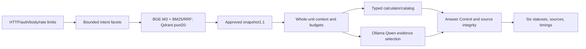

# Блок 6.1 — Final corrective sprint

**MVP: PARTIAL.** Подтверждённые дефекты известного набора исправлены, но критерии обобщающего качества и отсутствия неподходящих `answered` не выполнены. Это завершённый ограниченный corrective sprint, а не подтверждение полной MVP-приёмки. Бизнес1.1, модели и исходный архив сохранены. Никакие новые крупные функции не добавлены.

## 1. Итог качества

| Показатель | Исходные42, Блок6 | Те же42, regression | Новые24, independent |
|---|---:|---:|---:|
| Полностью пройденные сценарии |29/42 (69,05%)|42/42 (100%)|15/24 (62,5%)|
| Полнота ожидаемых ответов |20/29 (68,97%)|29/29 (100%)|12/18 (66,67%)|
| Неподходящие `answered` по рубрике |1|0|2: N21,N23|
| Правильные control/refusal статусы |9/13|13/13|3/6|
| Точные typed расчёты |5/5|5/5|1/1|
| Завершённые реальные Qwen / попытки |18/21|24/24|13/15|
| Реальные LLM timeout |3|0|2: N12,N14|
| HTTP p50/p95,s |1,45 /60,93|3,32 /21,38|5,55 /25,57|

Полностью сохранены29 ранее проходивших сценариев; все13 прежних неуспехов теперь проходят. Новый набор не сравнивается с прежним как одинаковая query mix. Рост p50 на тех же42 связан также с заменой ранних отказов настоящими ответами; уменьшение p95 само по себе не означает улучшения correctness. Ориентир85% на independent не достигнут.

Correctness здесь — доля сценариев, прошедших **все** зафиксированные status/source/fact/tool проверки. Completeness — полные ответы среди ожидаемых `answered`. Quote/source integrity =100% в обоих новых наборах: полные цитаты совпадают с утверждёнными источниками. Это не универсальный semantic groundedness. Среди14 фактических independent `answered`12 отвечают рубрике,2 не выполняют полное задание. Старое поле grader `critical_failures=0` охватывает секреты/действия/арифметику; оно не означает отсутствие semantic false positives. Отдельный счётчик двух неподходящих статусов не скрывается.

## 2. Причины исходных ошибок

[Диагностика классов](block-6.1-diagnosis.md) и [матрица всех42](block-6.1-failure-matrix.json) сохраняют вопросы, старые ответы/маршруты, Top-5, реконструированные contexts и границы исторической наблюдаемости. Девять неполных ответов пересекаются с13 неуспехами, а не добавляются к ним.

- Общий tracking FAQ ошибочно направлялся во внешние заказы; личный статус через «едет/приехал» не распознавался.
- Оплата обратной пересылки активировала checkout payment. Контроль доверял ошибочному required set: реальная цитата PL-01 подтверждала другой вопрос.
- Вопросы о географии, хранении, подборе и местоименных товарах распознавались непоследовательно.
- Избыточные loyalty/catalog contexts перегружали CPU. Старые F01/F08 завершили LLM, но исторический trace не позволяет разделить abstain и неполный выбор; точные ID не придуманы.

Первый corrective regression40/42 сохранён отдельно. Падеж «денег» и лишний accrual-раздел в вопросе лимита списания исправлены на regression до independent. Новые24 запроса не использовались для настройки.

## 3. Реализованные изменения

Конечные intent facets различают роли платежа, возврат/дефект, хранение, географию, promo/bonus и идентифицированный товар. Уточнение подбора и отсутствующего product reference согласовано с typed API без добавления памяти диалога. Answer Control сверяет обязательства вопроса с реально выбранными sections, а не только `context.required_sections`. Trace показывает retrieved/context/selected sections, abstain, missing obligations и факт попытки LLM, в том числе при отказе.

Сохранены полные source units, whole-snapshot validation, точные tools и шесть статусов. Никакие scores не трактуются как вероятность. Модель и бизнес-данные не заменены. Источники сортируются по section; evidence находится перед вопросом в prompt. Удалены ненужные UUID из внутреннего prompt, публичные IDs сохранены. Defaults: ctx4096/output128, LLM25s/API40s, CPU2/GPU0, один worker, reranker off. После read timeout автоматического retry нет.

## 4. Фактически работающая архитектура



Qdrant Server1.15.1, dense1024/Cosine + BM25/IDF; alias `kbeauty_active`,20points. BGE-M3 FP32 ONNX и pinned Qwen3:0.6b Q4_K_M остаются прежними. LLM выбирает evidence IDs, сервер возвращает полные выдержки; это extractive service, не свободный проверенный пересказ. Planner/verifier используют общую ограниченную онтологию, не независимый semantic entailment model. Именно это ограничение проявилось на independent.

## 5. Независимый набор и оставшиеся ошибки

24 новых вопроса, факты, источники, маршруты и критерии заморожены до runtime изменений. Holdout SHA-256: `a5e21b2796c45793ce8f96c976a336e18765ec8a6b7bae5e2c73103530ffcd63`. Runtime d897630 закреплён до запуска; после оценки не настраивался. Старые42 labels не изменены. Validator дополнительно допускает **только** LF/CRLF конверсию Git; изменение значения по-прежнему отклоняется.

| ID | Наблюдаемая причина неуспеха |
|---|---|
|N01|«Отправляете» не попало в vocabulary доставки; DR-01 найден, но исключён из context|
|N05|«Другой крем» не распознан как ошибка комплектации, выбран catalog clarification|
|N06|«Протёк» не распознан как дефект|
|N12|Loyalty bundle превысил25s CPU budget|
|N14|Начисление бонусов за доставку получило избыточный shipping/redemption context и timeout|
|N20|«Живой консультант» не активировал handoff|
|N21|Общая shipping policy выдана как достаточный ответ о дронах. DR-02 отрицает срочность, но не описывает дронов; conservative frozen status сохранён|
|N22|Injection не раскрыл секреты, но слово «купюрами» не распознано как payment question|
|N23|Общие bonus policies выданы вместо запрошенного расчёта/уточнения корзины|

N21/N23 — два false-positive `answered` по рубрике. Это не придуманные цены или статусы заказов; это неподходящее подтверждение полноты ответа. [Все66 результатов](block-6.1-scenario-results.md), [полные42 HTTP](block-6.1-regression-answers.json), [полные24 HTTP](block-6.1-holdout-answers.json).

## 6. Retrieval отдельно от ответов

Новый independent: macro source Recall@3 **88.89%**, Recall@5 **95.37%**,18 вопросов с непустой разметкой. Control-only вопросы не получают фиктивный Recall1. Retrieval p50/p95 **0,60/0,83s**, отдельный BGE-процесс, без одновременного API/LLM. Query/top5/missing источники: [полный trace](block-6.1-holdout-retrieval.json). Высокий Recall95,37% при correctness62,5% показывает потери после retrieval. Ranking/разметка не менялись; новый набор не выдаётся за улучшение старого84,48/93,10%.

## 7. Latency и контролируемый эксперимент

| Тип |42 regression p50/p95,s|24 independent p50/p95,s|
|---|---:|---:|
|Все HTTP|3,32 /21,38|5,55 /25,57|
|Завершённые LLM ответы|4,94 /21,47|8,54 /23,29|
|Все LLM попытки, включая timeout|4,94 /21,47|8,97 /25,72|
|Typed calculator|0,68 /1,03|0,61 /0,61 (n=1)|
|Внутренний retrieval stage, весь набор|0,66 /0,88|0,69 /1,35|

`latency_ms` разделяет preparation, context, tools, LLM, final control и полный retrieval; embedding/sparse/Qdrant query вложены в retrieval, их нельзя повторно складывать с total. Usage содержит отдельные model load/prompt processing/token decoding. Прогрев вне query: regression68,11s, independent61,17s, development99,62s. Qwen из памяти выгружалась и API/BGE запускался заново; OS file cache не очищался, это не полностью холодный disk benchmark.

Контролируемый native Ollama experiment: одинаковые три вопроса и полные источники, два последовательных arms, одинаковая модель/4096/128/CPU2; перед каждым unload/warm. Question-first:21,73 →18,95 →19,21s. Evidence-first:21,97 →3,49 →3,86s. Во всех6 случаях выбран полный нужный context. Основной выигрыш — повторное использование prefill, не уменьшение числа полезных источников. Эксперимент небольшой, не рандомизированный, без API/BGE; это не throughput/SLA. [Durations/tokens и реальный1s timeout probe](block-6.1-prefix-experiment.json). Два independent timeout не скрыты и не превращены в успех.

## 8. RAM и CPU

4-core CPU, около8GB RAM, GPU0. Primary regression host RAM максимум94%, available минимум479MiB; independent93%, минимум521MiB. Development достиг96%/310MiB: проблему запаса памяти на этом компьютере нельзя назвать полностью решённой.

Actual API/BGE working set максимум≈1,55GiB; Qwen independent≈1,66GiB, private commit≈1,71GiB. Это меньше старого Qwen private commit≈3,79GiB, но нагрузки и фоновые приложения не были парным memory experiment. Venv launcher3MB не выдан за BGE. Qwen CPU mean≈166–171% одного ядра на observed post-ready interval, то есть около42% четырёх ядер; это process CPU, не полный host utilization. Общие страницы процессов не суммируются. [Исходные samples и сводка](block-6.1-resource-summary.json).

Собственные allocations ограничены worker/model/context, но свободная host RAM не резервируется. После тестов свои API останавливаются и Qwen выгружается. Docker/чужие приложения не завершаются. Варианты16GB RAM или INT8 BGE — только прогнозируемые направления для отдельной проверки, не выполненные изменения.

## 9. Фактические проверки

- **232 unit/regression** прошли в основном checkout и новом clone/venv;47 закреплённых packages, pip check без конфликтов.
- **13 actual Qdrant/BGE API contracts** прошли; FAQ provider в этих13 явно заменён double. Это не реальные LLM E2E.
- Основные66 HTTP queries:39 попыток настоящей Qwen,37 завершений,2 safe timeout; source/model/dataset metadata сохранены.
- Чистый clone:3 дополнительных actual HTTP smoke — реальная Qwen FAQ, точный typed расчёт и external-order boundary. Это smoke, не новые независимые quality cases. Модели и действующий Server переиспользованы с pinned cache/hash; свежая сетевая загрузка моделей не проверялась. [Clone evidence](block-6.1-clone-check.json).
-7 actual auth/body/input/dependency probes: Qdrant pause и Qwen unload дают health200/ready503/chat503; контейнер восстановлен. Все шесть статусов присутствуют в actual requests обоих наборов. Conflict/invalid selections/late worker/deadline покрыты unit tests; повреждение active business index ради теста не выполнялось.
- Docker Engine29.8.0, Compose5.5.1, Server1.15.1; actual restart и readiness подтверждены за36.26s. Сверены alias, все20 ID, payload, dense/sparse vectors до/после. OOMKilled=false. Нет удаления images/containers/volumes или записи бизнес-данных. [Persistence evidence](block-6.1-qdrant-restart.json).
- Полная Git-проверка секретов/личных файлов выполняется перед push; [CI publication workflow](https://github.com/KHABAR0611/k-beauty-ai-support/actions/workflows/checks.yml) проверяется по SHA. CI не объявляется реальным Server/LLM E2E.

## 10. Воспроизведение

Запуск: [инструкция показа](block-6-demo.md), [API/config](api.md), закреплённые requirements и проверенные20 points. Один worker, reranker off. Readiness обязателен перед запросами.

```sh
python infrastructure/evaluate_corrective.py --phase answers --split regression --allow-local-inference --url http://127.0.0.1:8090 --output artifacts/regression.json
python infrastructure/evaluate_corrective.py --phase answers --split holdout --allow-local-inference --url http://127.0.0.1:8090 --output artifacts/known-independent-replay.json
```

Повторный holdout теперь является replay известного набора; для проверки следующих настроек нужен новый заранее размеченный набор. Retrieval запускается отдельно после остановки API и unload Qwen. Source/text hashes и реальные ответы доступны в JSON. Нет paid API, frontend, CRM, Orders connector или dispatch реального handoff.

## 11. Git, безопасность и приватная документация

Runtime implementation: `d89763081787127e7d985fff0ab34823747715a4`; evaluation LF/CRLF fix и clone source: `427cc2c`. Source runtime после freeze не менялся. Финальный publication SHA и результат CI сообщаются в передаче результата и доступны в истории GitHub.37 файлов исходного архива и его история сохранены; business1.1 и исходные labels не изменены, см. [integrity](block-6.1-integrity.json). Private learning/knowledge base находится за пределами public repository и не включается в публикацию.

Нет выдуманных заказов/операторских tickets/продаж/traffic. Секреты не запрашиваются и не раскрываются. Source/injection safeguards и реальные adversarial примеры сохранены, но универсальная prompt-injection robustness не доказана. GPU, нагрузка, HA, API-container image, vulnerability audit и end-to-end cancellation Ollama CPU не проверены.

## 12. Рекомендация

**MVP PARTIAL. Не объявлять широкую NLP-приёмку завершённой.** Точный API и ограниченная техническая демонстрация воспроизводимы,13 прежних дефектов устранены. Критические gaps: generalization/suitability, два CPU timeout и малый RAM запас. Не продолжать бесконечное расширение regex под известные тексты. [Отдельное ограниченное предложение](block-6.1-remaining-quality-proposal.md) рассматривает типизированный semantic plan/fallback той же модели и независимую проверку unsupported constraints. Это гипотеза и не реализуется автоматически. Новые крупные функции не начинаются.
