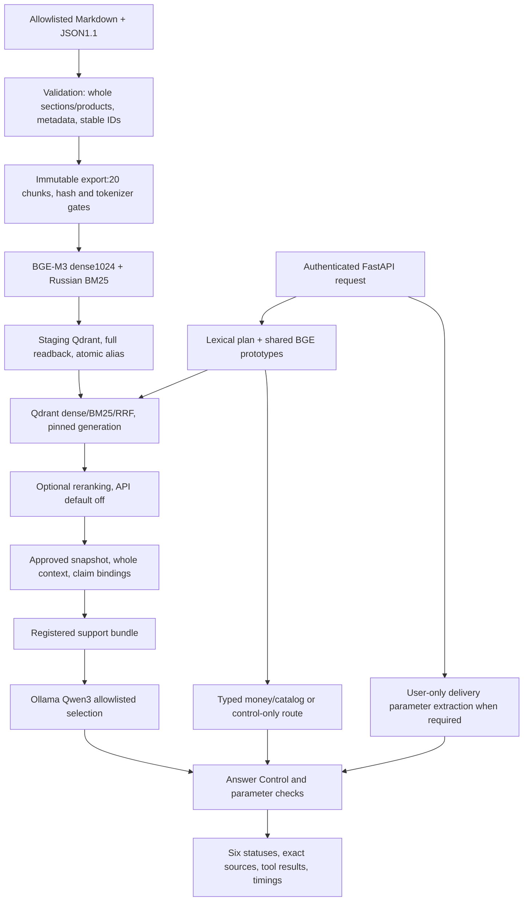

# Project closure — Engineering Prototype / MVP PARTIAL

Цикл K-Beauty AI Support закрыт решением владельца20.10.2026. Дальнейшие corrective sprints в текущем цикле прекращены. Зафиксирован работающий инженерный прототип; свободная клиентская поддержка не прошла приёмку. Production-ready или stable release не заявляются.

Эта поставка меняет только документацию жизненного цикла. Runtime, business data1.1, тестовые эталоны, конфигурация и результаты независимых запусков сохранены относительно442c028. Новых model runs, повторного independent evaluation и улучшения метрик при закрытии нет. Планируемая метка `research-cycle-1-partial` обозначает исследовательский snapshot, не рекомендацию deployment.

## Фактически реализованная архитектура

Retrieval pool20 охватывает весь текущий корпус20; это проверка покрытия маленького snapshot, не доказанная стратегия большого каталога. LLM выбирает evidence/bundle, сервер выводит целые исходные sections. Свободный генеративный синтез и универсальная semantic entailment проверка не реализованы. Source provenance и task suitability — разные границы.

## Подтверждённые компоненты и пределы

| Компонент | Доказательство | Ограничение |
|---|---|---|
| Ingestion/chunking |11 policy sections+9 products; deterministic generations, whole conditions, metadata | Нет сравнительного benchmark chunkers/long PDF |
| Dense embeddings | Pinned BGE-M3 FP32 ONNX1024/Cosine,20 vectors,140–268 tokens | CPU/RAM дорогие; иная модель/GPU не оценены |
| Qdrant Server |1.15.1, full payload/dense/sparse readback, atomic publish/query pin; update/delete/interruption/restart | Нет HA, distributed publisher, GC/backup restore proof |
| BM25/Hybrid RRF | Русский analyzer, SKU normalization, реальные три modes; mixed quality | Стемминг не перевод; fusion имеет регрессии |
| Optional reranking | MiniLM actual ONNX, off/failure fallback | Primary10 терял Recall5 и увеличивал latency; API default off |
| FastAPI/Ollama | Реальный HTTP и pinned local Qwen3:0.6b; readiness/dependency errors | Stateless, extractive selection; не все формулировки обслуживаются |
| Typed tools | Money7/7 в финальных наборах, catalog exact fields | User-declared inputs; нет реального bonus balance/stock/Orders |
| Answer Control | Шесть статусов, pending handoff, source/claim/parameter checks | Реализован, но semantic reliability не принята |
| Docker/tests/CI | Настоящий Qdrant/Compose, units и реальная интеграция в отчётах | CI не actual-model E2E; API image/load/security audit не заявлены |

Полные свидетельства: [Блок2](block-2-results.md), [Блок3](block-3-results.md), [Блок4](block-4-results.md), [Блок5](block-5-results.md), [Блок6](block-6-results.md), [6.1](block-6.1-results.md), [6.2](block-6.2-results.md).

## Итоговые измерения

| Показатель | Результат | Scope |
|---|---:|---|
| Independent correctness |16/24 =66,67% | Один frozen final run, новые синтетические вопросы |
| Expected-answer completeness |12/18 =66,67% | Знаменатель — expected answered |
| Семантически неподходящие answered |3 | H06/H13/H14; ещё H12 FAIL по избыточному source requirement |
| Recall@3 / @5 |93,06% /95,83% |18 новых queries с непустой relevance |
| Quote/source integrity |100% среди16 answered | Не semantic task adequacy |
| Known regression |36/42 и21/24 | Прежде42/42 и15/24; семь ранее PASS потеряны суммарно |
| Точные расчёты |7/7 | Typed deterministic paths в трёх финальных наборах |
| HTTP p50/p95 |5,46 /14,79 s | New24, warm; включает ошибки и быстрые controls |
| Cold readiness |100,24 s | Модель выгружена, API новый, OS cache не очищен |
| RAM host |До94% | Машина около8GB, процессы/ОС/Docker вместе |
| Финальные unit tests |259 passed | Active и clone; CI scope см. workflow |
| Integration contracts |13 passed | Real Qdrant/BGE, FAQ provider явно doubled |
| Actual HTTP evaluation |90 requests |61 started Qwen requests/80 subcalls attempted/70 completed |
| Safe parameter errors |10/90 |502/system_error, не успешное обслуживание |

Официальные16/24 не пересчитаны после выявления избыточного источника H12. Три semantic false answered и один rubric-only FAIL раскрыты отдельно в [audit](block-6.2-rubric-audit.json). Эти результаты — source-based technical review, не blind human judging и не реальные клиентские исходы. Старое `critical_failures=0` не покрывало неподходящие answered.

## Known Limitations и дальнейшая граница

P1: неправильный intent/source family, неполные составные ответы, ложноположительные answered и лишние безопасные502 на корректных вопросах. P2: высокий RAM, холодный старт и tail latency на старом CPU. Реальные заказы, платежи, stock, customer identity/ownership и доставка обращения оператору не подключены; handoff.created=false. Нет заявлений о реальных клиентах, продажах, traffic или SLA. Данные магазина вымышлены.

Нужны отдельные решения для query decomposition, semantic verification, более способной модели, персональных API/ACL и human dispatch. Они не реализуются автоматически. Рабочий код и исследовательская история сохраняются, новые technical blocks не начинаются без отдельного задания.

## Воспроизводимый технический показ

См. [точные проверенные сценарии](demo-verified-scenarios.md), [полный запуск](block-6-demo.md), [API/config](api.md), [технический case study](engineering-case-study.md) и [проверки закрытия](project-closure-checks.json). Показать одновременно verified success и неуспешные H13/H14; отдельный удачный FAQ не доказывает принятие свободного ассистента.
