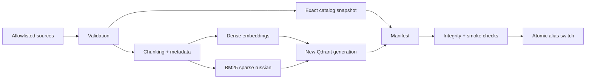
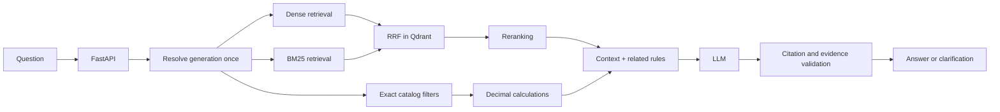
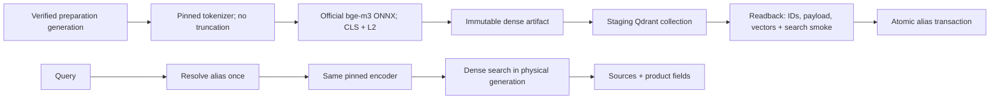

# Архитектура K-Beauty AI Support

Статус: архитектура 0.4.0. Реализованы source preparation, dense BAAI/bge-m3, generation publishing и dense query с источниками в Qdrant Server. BM25/RRF/reranking, LLM и API на схемах ниже относятся к последующим этапам. Текущий индекс содержит только named vector dense; sparse vector ещё не создаётся.

## Indexing pipeline

## Query pipeline

BM25 вычисляет лексическую релевантность; dense поиск — смысловую близость. RRF объединяет позиции кандидатов, не складывая несопоставимые scores. Reranker после fusion оценивает пары вопрос/фрагмент. Эти этапы не взаимозаменяемы.

Qdrant хранит named vectors `dense` и `bm25` одного point; sparse index использует IDF modifier. Запрос: `query_points`, два prefetch и RRF. В базе server/client 1.15.1 не использовать новые параметры RRF из более поздних версий; стартовать с server default, затем проверить интеграционно. [Query API](https://qdrant.tech/documentation/search/hybrid-queries/).

Гипотеза глубины: dense=20, sparse=20, fusion=20, rerank=8. Далее расширение связанных разделов и ограничение token budget. Эти числа — настройки эксперимента, не доказанные оптимумы. Score поиска не является вероятностью истинности.

## Каталог и вычисления

JSON остаётся каноническим источником SKU/цен/свойств. Поиск по описанию даёт кандидатов, точные поля проверяются по snapshot того же поколения. В manifest collection включить catalog hash и snapshot. При старте запроса разрешить alias один раз и закрепить физическую collection со snapshot на весь запрос. Несовпадение версий блокирует ответ. Денежные расчёты — Decimal по PL-05 вне LLM.

## Обновление и идемпотентность

Неизменный source/analyzer/model manifest — no-op. Изменение данных создаёт staging collection нового поколения. UUIDv5 по логической идентичности chunk обеспечивает повторяемый upsert внутри поколения. Проверка counts, hashes и retrieval-smoke предшествует atomic alias switch. Удалённых chunks в новом поколении нет: одного upsert недостаточно для очистки старых записей.

Сбой до публикации сохраняет прежний active index. Повторный запуск продолжает то же staging-поколение. Единственный publisher защищён файловой блокировкой в однопроцессном режиме; распределённая блокировка — отдельный этап. Прежние поколения хранятся до окончания retention и in-flight запросов. Откат — alias на прошлый проверенный manifest. Этот механизм пока специфицирован, не реализован.

## Недостаточные основания

Не хватает города, способа доставки, баланса или статуса первого заказа — `needs_clarification`. Нет подтверждения факта — `insufficient_evidence`. Недоступен Qdrant/provider — 503/504, а не ложный ответ «не найдено». Ссылки обязаны принадлежать переданному context; числовые поля — точному snapshot. Самооценка LLM не является проверкой фактов.

## Границы доверия

Ingestion читает только allowlist трёх файлов, не произвольный путь/URL из HTTP. Документы и вопросы — недоверенные данные. Query-процесс не имеет инструментов изменения индекса, возвратов денег и доступа к платёжным секретам. Нормализованный текст и hashes не содержат PII. Безопасность и отказоустойчивость — `operations.md`.

## Развёртывание

Сейчас Compose содержит Qdrant с persistent volume и одноразовый source-audit. Позже API — отдельный долгоживущий контейнер, ingestion — batch job с write-доступом. Dense/BM25/reranker adapters исполняются в процессе либо выносятся в model services после измерения ресурсов. LLM — внешний endpoint. Пока нет действующих моделей, отдельные фиктивные model/API контейнеры не добавляются.

## Бизнес-база1.1

По ADR-016 расчёт: promo → bonus (cap20% после promo) → delivery threshold после обоих. KB-004=1890, KB-005=1590. Pricing всё ещё будущий компонент; текущие tests проверяют source/expected consistency, не работающий API.

## Реализованная dense-граница 0.4.0

Model/tokenizer/runtime fingerprints и catalog hash входят в descriptor каждого point. UUIDv5 Блока1 сохраняется; source text, structured product и price_kopecks не смешиваются между товарами. Полный verify предшествует переключению. Source CURRENT и Qdrant alias — разные границы публикации: локальный source export сам по себе не меняет индекс. [Контракт и эксплуатация](block-2-spec.md), [результаты](block-2-results.md). Метрики относятся только к dense retrieval, без LLM.
