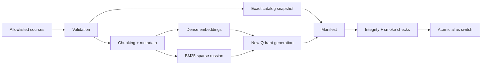
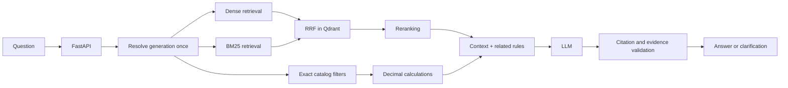
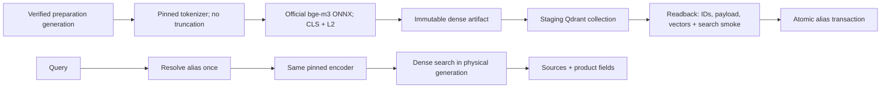
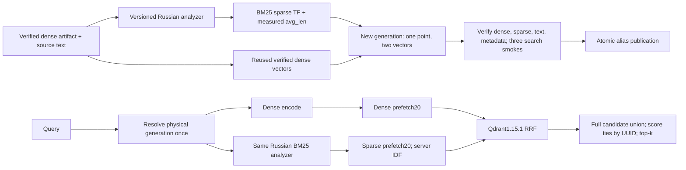
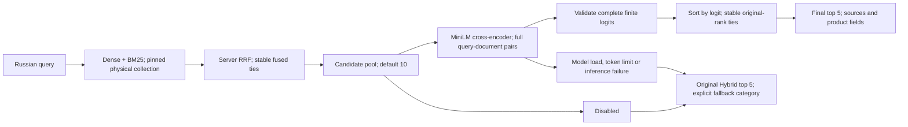
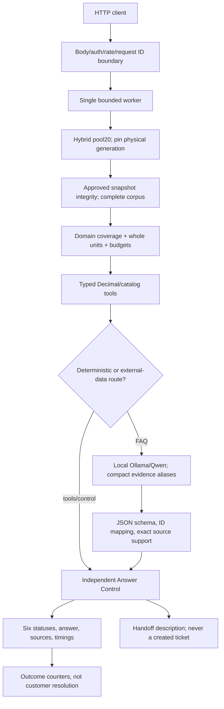

# Архитектура K-Beauty AI Support

Статус0.7.0: ingestion, dense/BM25/RRF, optional reranker, FastAPI, versioned tools и локальный Ollama adapter реализованы. Исторические схемы ниже отделены от актуальной API-границы. Default provider disabled; реальная генерация/ошибки и тестовые doubles описаны в отчёте Блока5. Не подключены заказы, платежи и операторская система.

## Indexing pipeline

## Query pipeline

BM25 вычисляет лексическую релевантность; dense поиск — смысловую близость. RRF объединяет позиции кандидатов, не складывая несопоставимые scores. Reranker после fusion оценивает пары вопрос/фрагмент. Эти этапы не взаимозаменяемы.

Qdrant хранит named vectors `dense` и `bm25` одного point; sparse index использует IDF modifier. Запрос: `query_points`, два prefetch и RRF. В базе server/client 1.15.1 не использовать новые параметры RRF из более поздних версий; стартовать с server default, затем проверить интеграционно. [Query API](https://qdrant.tech/documentation/search/hybrid-queries/).

Гипотеза глубины: dense=20, sparse=20, fusion=20, rerank=8. Далее расширение связанных разделов и ограничение token budget. Эти числа — настройки эксперимента, не доказанные оптимумы. Score поиска не является вероятностью истинности.

## Каталог и вычисления

JSON остаётся каноническим источником SKU/цен/свойств. Поиск по описанию даёт кандидатов, точные поля проверяются по snapshot того же поколения. В manifest collection включить catalog hash и snapshot. При старте запроса разрешить alias один раз и закрепить физическую collection со snapshot на весь запрос. Несовпадение версий блокирует ответ. Денежные расчёты — Decimal по PL-05 вне LLM.

## Обновление и идемпотентность

Неизменный source/analyzer/model manifest — no-op. Изменение данных создаёт staging collection нового поколения. UUIDv5 по логической идентичности chunk обеспечивает повторяемый upsert внутри поколения. Проверка counts, hashes и retrieval-smoke предшествует atomic alias switch. Удалённых chunks в новом поколении нет: одного upsert недостаточно для очистки старых записей.

Сбой до публикации сохраняет прежний active index. Повторный запуск продолжает то же staging-поколение. Единственный publisher защищён файловой блокировкой в однопроцессном режиме; распределённая блокировка — отдельный этап. Прежние поколения хранятся до окончания retention и in-flight запросов. Откат — alias на прошлый проверенный manifest. Staging/readback/atomic alias реализованы; автоматический retention/GC и распределённая блокировка не реализованы.

## Недостаточные основания

Не хватает города, способа доставки, баланса или статуса первого заказа — `clarification_needed`. Нет подтверждения факта — `insufficient_context`. Недоступен Qdrant/provider — 503/504, а не ложный ответ «не найдено». Ссылки обязаны принадлежать переданному context; числовые поля — точному snapshot. Самооценка LLM не является проверкой фактов.

## Границы доверия

Ingestion читает только allowlist трёх файлов, не произвольный путь/URL из HTTP. Документы и вопросы — недоверенные данные. Query-процесс не имеет инструментов изменения индекса, возвратов денег и доступа к платёжным секретам. Нормализованный текст и hashes не содержат PII. Безопасность и отказоустойчивость — `operations.md`.

## Развёртывание

Сейчас Compose содержит Qdrant с persistent volume и одноразовый source-audit. Позже API — отдельный долгоживущий контейнер, ingestion — batch job с write-доступом. Dense/BM25/reranker adapters исполняются в процессе либо выносятся в model services после измерения ресурсов. LLM — внешний endpoint. API/модели работают нативно; отдельные model/API контейнеры не добавлены и не проверены.

## Бизнес-база1.1

По ADR-016 расчёт: promo → bonus (cap20% после promo) → delivery threshold после обоих. KB-004=1890, KB-005=1590. Pricing реализован versioned tool в0.7.0; source consistency и работающий API проверяются раздельно.

## Реализованная dense-граница 0.4.0

Model/tokenizer/runtime fingerprints и catalog hash входят в descriptor каждого point. UUIDv5 Блока1 сохраняется; source text, structured product и price_kopecks не смешиваются между товарами. Полный verify предшествует переключению. Source CURRENT и Qdrant alias — разные границы публикации: локальный source export сам по себе не меняет индекс. [Контракт и эксплуатация](block-2-spec.md), [результаты](block-2-results.md). Метрики относятся только к dense retrieval, без LLM.

## Реализованная hybrid-граница0.5.0

Dense-only и BM25-only обходят fusion; BM25-only не загружает BGE-M3. Prefetch и RRF не меняют сохранённые dense values. Descriptor включает исходный dense artifact hash и sparse analyzer signature/asset/runtime/avg_len. Любая смена representation требует нового поколения; validation заново вычисляет sparse от payload text. Изменение/удаление документов пересчитывает corpus average и sparse vectors, затем переключает alias только после full readback. Запрос сохраняет physical collection на всю операцию. [Контракт](component-contracts.md), [анализатор](bm25-russian.md), [проверки](block-3-results.md).

## Reranking boundary 0.6.0

Reranking не меняет коллекцию или её generation. Уже извлечённые тексты и метаданные передаются целиком; дополнительных чтений через alias между scoring и ответом нет. Original RRF score сохраняется отдельно от raw rerank_score. Positions journal содержит только ID, before/after и scores; запросы, тексты и exception messages не логируются. Измеряются retrieval/rerank/total duration. Ошибки сети Qdrant и несовпадение fingerprints остаются ошибками retrieval, не маскируются reranker fallback.

FP32 ONNX выполняется локально через тот же Runtime, CPU2 threads, batch1, без remote code. Hash/size/revision gate предшествует session creation. Предел512 относится к паре query/document вместе со special tokens; silent truncation отсутствует. Неполный набор scores никогда не становится частично отсортированным ответом. Модель не получает qrels или ID ожидаемых источников. [Выбор модели](reranker-model-selection.md), [план](block-4-experiment-plan.json), [результаты](block-4-results.md).

Текущая реализация синхронная и не имеет жёсткого прерывания зависшего native inference. Конкурентная нагрузка, отдельный worker, circuit breaker, request deadline и warm readiness требуют следующего инженерного решения перед HTTP-эксплуатацией. Наличие fallback не доказывает latency SLO. Reranker нельзя применить к источнику, отсутствующему в candidate pool; полнота составного вопроса ограничена final_k.

## API/generation boundary0.7

For this small corpus the retriever returns all20 candidates. Top5 quality is still measured separately and unchanged; full required-source coverage is a context planning strategy, not a new retrieval score. Exact catalog absence is established only after all20 IDs/payload match the approved source snapshot, including9 products. No implicit facts are inserted from arbitrary local files. Query/source/model generations remain checked; API has no indexing endpoint.

A single shared encoder uses CPU2 threads; a single worker prevents concurrent model heaps. Background warmup keeps health available; ready requires index/readback/model/provider/auth. External LLM has local-only URL, digest gate, explicit cold warmup, constrained JSON schema, pinned tokenizer budget and no paid fallback. Source aliases map back to full UUIDs. Confirmed business facts originate from immutable full source units or versioned deterministic tools, not unchecked free paraphrase.

Error mapping, structured logging and status logic are separate. Transport/provider failures cannot become successful answers. Clock-based rate/body/deadline limits are process-local. Native inference cannot be force-stopped safely; deadline does not release the worker until it completes. No HA, distributed limits, real handoff dispatch or production readiness is claimed.
